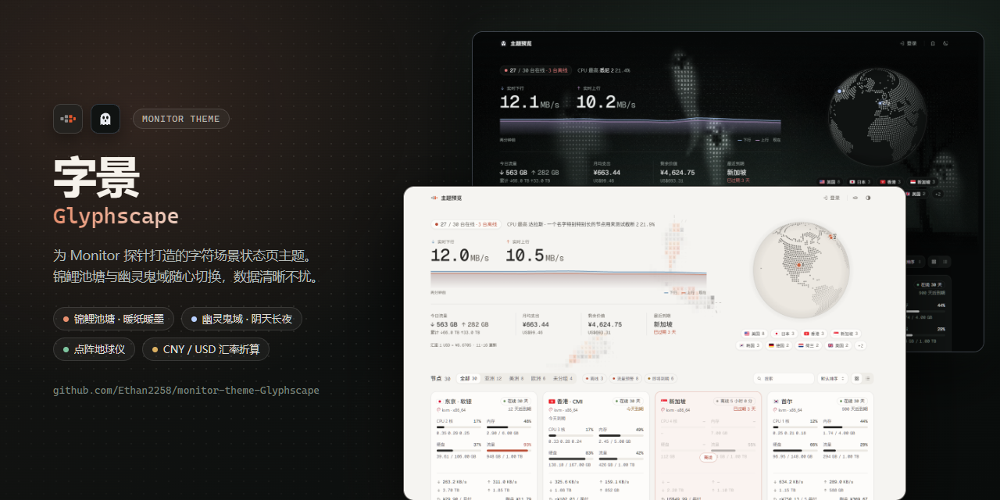
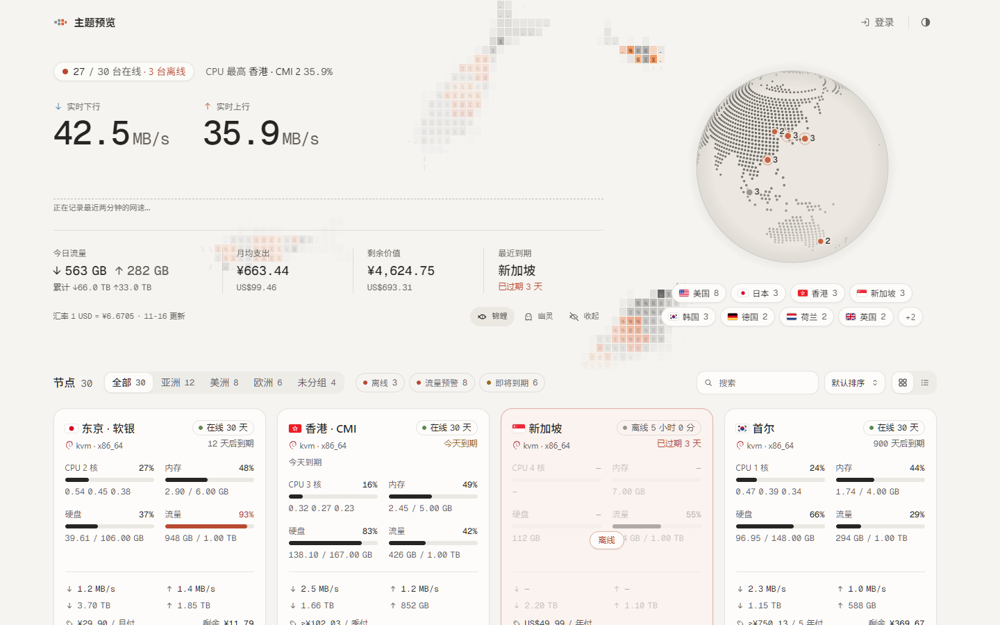
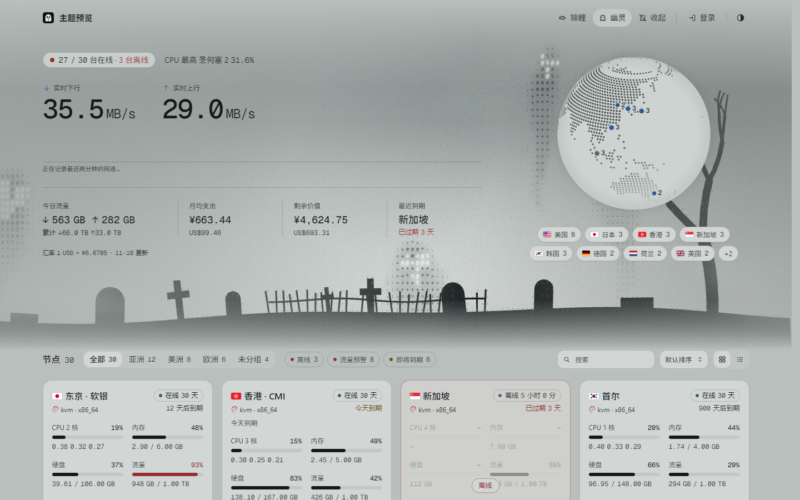
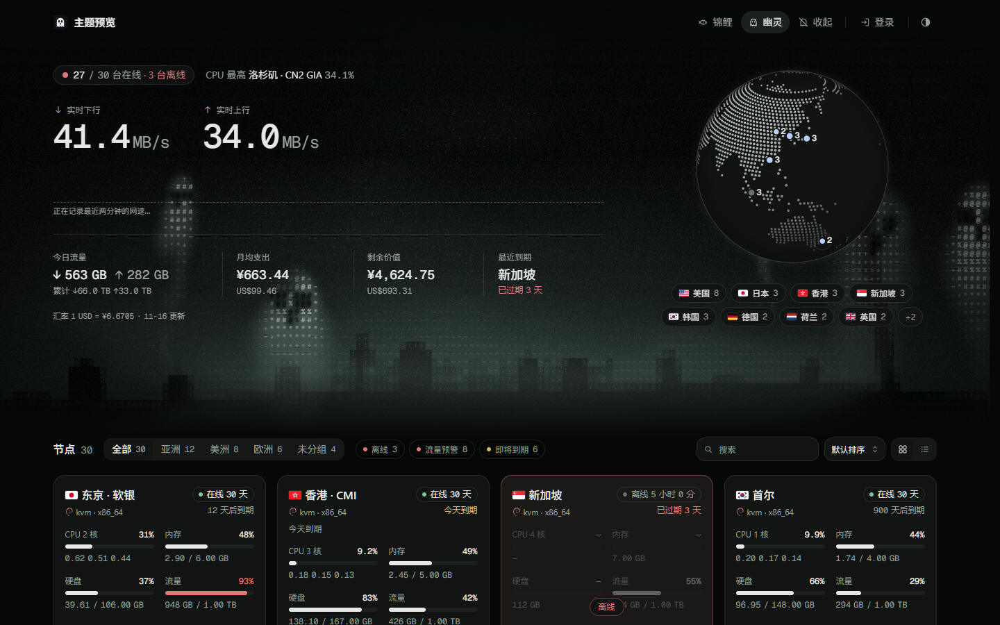
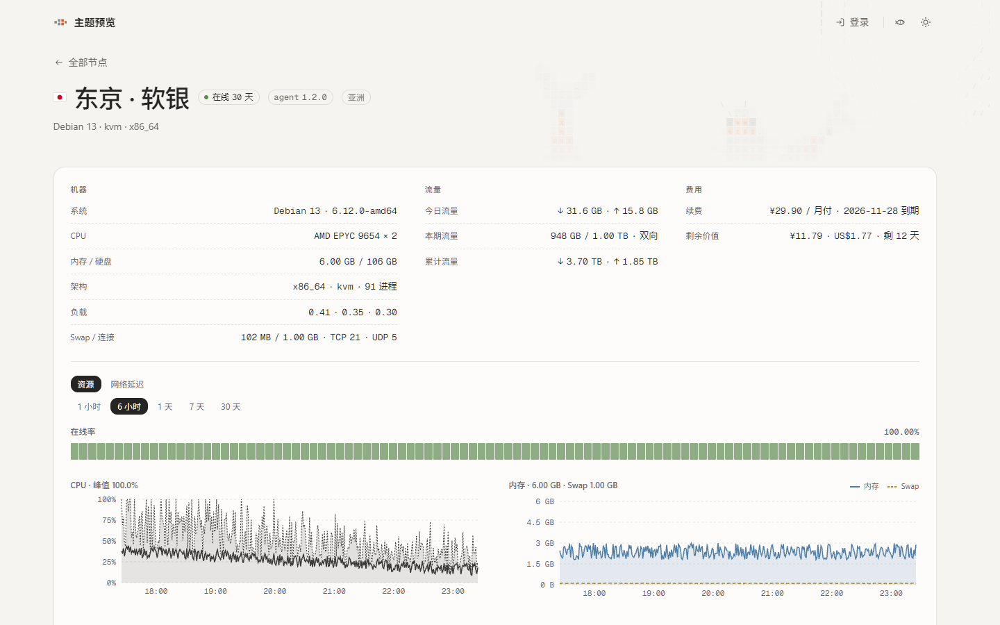

# 字景 · Glyphscape

[](https://github.com/Ethan2258/monitor-theme-Glyphscape/releases/latest)
[](LICENSE)
[](https://github.com/monitor-probe/monitor)

[Monitor](https://github.com/monitor-probe/monitor) 探针公开状态页主题：保留默认主题的清晰版式，页首嵌一片可随时切换的字符场景（**锦鲤池塘** / **幽灵鬼域**），随场景联动配色与图标，配有可交互点阵地球仪、双币种成本折算与详情页监控图表。

> 原名「墨池 · Inkpond」，主题标识 `inkpond` 保持不变。已安装旧版的站点直接在面板点击更新即可，原有设置不受影响。



## 核心特性

- **双字符场景，随时切换或收起**：字符角色只在页首范围活动，游过文字、卡片与图标下方会自动退让或变淡，下方节点卡片读数不受干扰；浏览器标签页图标与页头站名图标随场景切换，收起时恢复默认三道杠图标与默认配色（站长自己上传的站点图标除外）。
- **场景配色与丝滑切换**：锦鲤配暖纸与暖墨，幽灵配灰绿阴天与无月长夜。切换场景或深浅色时，旧页面化作快照在半秒多里淡出，只动透明度，实测桌面约 155 帧；切换场景时下方列表平滑移到新位置，切换深浅色时池塘还会荡开字符涟漪。进出节点详情页同样淡入淡出，总览网速数字平滑滚动。
- **点阵地球仪**：陆地由细密墨点构成，节点所在国家标以彩色脉动珠子（锦鲤为赤陶橙、幽灵为冷蓝），支持拖拽旋转；点击珠子或下方地区标签即可按地区筛选。
- **人民币 / 美元实时折算**：总览统计月均支出与剩余价值合计（主要货币在上、另一种在下），卡片与详情页按选定货币标价并支持悬停查看原价。汇率每日自动从三个公开源（Cloudflare 镜像、jsDelivr、欧洲央行 Frankfurter）取最新一日汇率（长开页面每小时检查一次），也可关闭以禁用第三方请求。
- **三网延迟**：节点卡片底部列出电信、联通、移动（或站长指定的探测点）的当前延迟、最近一段时间的色块条（越深越慢，红色为超时）和丢包率，一眼看出哪个时段最慢；详情页信息栏和表格视图也会显示。需要在 hub 中配置延迟探测。
- **筛选、双视图与详情页**：支持分组标签与「离线 / 流量预警 / 即将到期」状态快捷筛选（管理员登录后含「不公开」），提供关键词搜索、9 种排序与卡片 / 表格双视图切换；节点详情页包含在线率条、CPU 峰值带、内存与 Swap、实时网速、硬盘、TCP/UDP 连接数与进程数，以及带削峰与探测开关的多线延迟曲线。
- **后台无缝切换与缓存复用**：停留在首页时提前预加载后台资源，点击「后台 / 登录」原地平滑过渡至 `/admin/nodes`；本地缓存最近状态与配置，刷新或从后台点击「状态面板」返回时直接首帧呈现。

## 场景与截图

| | 锦鲤池塘（`pond`） | 幽灵鬼域（`wraith`） |
|---|---|---|
| 交互玩法 | 字符锦鲤在页首游动，点击空白水面撒鱼食吸引鱼群 | 幽灵在坟地上空飘荡，鼠标悬停时围拢，点击一下会被惊散 |
| 浅色外观 | 暖纸 | 雾白的灰绿阴天 |
| 深色外观 | 暖墨 | 没有月亮的长夜 |
| 字符引擎 | [ascii-pond](https://github.com/stqfdyr/ascii-pond) | [ascii-ghost](https://github.com/Ethan2258/ascii-ghost) |

| 锦鲤池塘（浅色） | 幽灵鬼域（浅色） |
|---|---|
|  |  |
| **幽灵鬼域（深色）** | **节点详情页** |
|  |  |

## 安装与更新

### 方法一：从 GitHub 安装（推荐，hub 1.3.2+）

在 hub 面板「主题」页填入本仓库地址，点击「从 GitHub 安装」，之后的新版本可在主题卡片上一键更新：

```text
https://github.com/Ethan2258/monitor-theme-Glyphscape
```

### 方法二：手动上传安装包

从 [Releases](https://github.com/Ethan2258/monitor-theme-Glyphscape/releases/latest) 下载 `theme.tar.gz`（**不要**下载 Source code），在面板「主题」页上传安装。

## 主题设置

在面板主题卡片的设置里调整，保存后刷新公开页生效（设置公开可读，只控制展示不管权限）：

| 设置项 | 默认值 | 说明 |
|---|---|---|
| 公告 | 空 | 显示在页首，纯文本 |
| 显示总览 / 地球仪 / 搜索与排序 | 开 | 各自独立开关 |
| 默认配色 | 跟随系统 | 可设为跟随系统、暖纸（浅色）或暖墨（深色）；访客手动切换后以其选择为准 |
| 页脚文字 | 空 | 显示在页面底部 |
| 显示价格 | 开 | 卡片和详情页的价格与剩余价值 |
| 显示月均支出 | 开 | 总览里的月均支出与剩余价值合计 |
| 主要货币 | 人民币 | 合计与折算以它为主，另一种写在旁边（人民币 / 美元） |
| 实时汇率 | 开 | 关闭后使用内置参考汇率，页面不向第三方发请求 |
| 显示三网延迟 | 开 | 卡片底部、详情页信息栏和表格视图显示延迟；需要 hub 已配置延迟探测 |
| 显示的探测点 | 空 | 按名称用逗号分隔，如「电信,联通,移动」；留空自动选电信、联通、移动，没有时取前三个 |
| 色块时间范围 | 最近 1 小时 | 卡片色块条覆盖的时间：1 / 6 / 24 小时 |
| 显示背景场景 | 开 | 关闭后不渲染页首场景；开启时访客可在页头切换「锦鲤 / 幽灵 / 收起」 |
| 默认场景 | 锦鲤池塘 | 锦鲤池塘或幽灵鬼域，各自对应一套浅/深色配色；访客自选优先于默认 |
| 允许投喂 / 锦鲤数量 | 开 / 按窗口大小 | 仅对锦鲤池塘有效 |

## 路由与反代说明

`/` 为列表页，`/node/{id}` 为节点详情页。若 hub 前方配有按路径放行的反向代理或 WAF，除 `/` 外还需放行 `/node/`，以及 `/favicon.svg`、`/apple-touch-icon.png`、`/boot.js`。

## 本地开发

```bash
npm ci
npm run demo                                        # 本地演示：内置 30 个模拟节点，不需要后端 hub
MONITOR_HUB=https://hub.example.com npm run dev     # 使用公开状态页的真实 hub 作为数据源
npm run build && npm run lint && npm test           # 构建、静态检查与单元测试
npm run pack                                        # 构建并用与 hub 一致的校验打包生成 theme.tar.gz
```

演示模式下可在 URL 里附带参数快速调试：`?theme=dark`、`?config={"notice":"…"}`、`?reset`。陆地位图由 `npm run land` 从 Natural Earth 数据生成并已提交至仓库，日常构建无需重新生成。

## 许可与致谢

本项目基于 MIT 协议开源，见 [LICENSE](LICENSE)。

- 版式与基础实现基于 [monitor-theme-default](https://github.com/monitor-probe/monitor-theme-default)
- 锦鲤池塘引擎来自 [ascii-pond](https://github.com/stqfdyr/ascii-pond)
- 幽灵鬼域引擎来自 [ascii-ghost](https://github.com/Ethan2258/ascii-ghost)
- 其他第三方声明见 [THIRD_PARTY_NOTICES.md](THIRD_PARTY_NOTICES.md)
