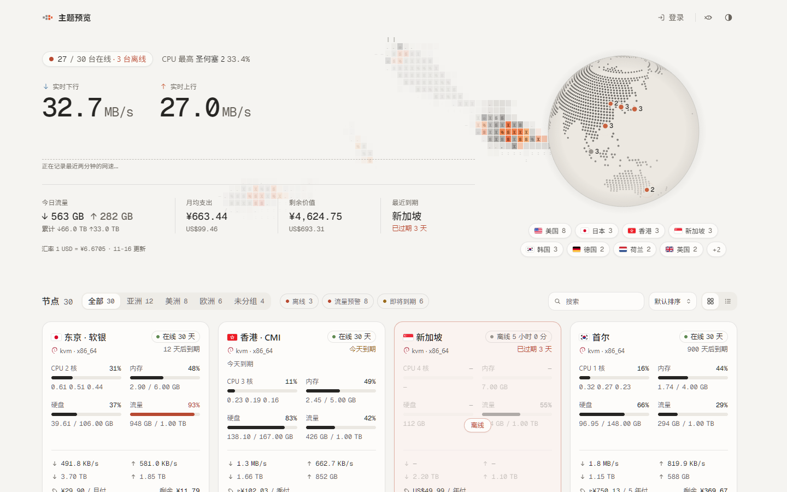

# 墨池 · Inkpond

[Monitor](https://github.com/monitor-probe/monitor) 探针的主题：默认主题的版式，页首放一片字符场景——锦鲤池塘或幽灵鬼域，访客可以随时切换。



- **场景在页首，两种可切换。** 字符锦鲤只在页面顶部那片水里游，或者换成幽灵在坟地上空飘；总览和地球仪直接浮在上面，鱼和幽灵经过文字下方会自动变淡；往下是实心的节点卡片，读数不受干扰。
- **每个场景一套配色**：锦鲤池塘是暖纸与暖墨，幽灵鬼域是灰绿的阴天与长夜。站长在设置里选默认场景，访客在总览下方选「锦鲤 / 幽灵 / 收起」，切换时颜色平滑渐变。
- **点阵地球仪**：陆地是细密的墨点，节点是赤陶色的珠子，可拖动；点珠子或下面的地区标签即按地区筛选。
- **价格只算人民币和美元**：总览显示月均支出和剩余价值（主要货币在上、另一种在下），汇率每天自动更新（同时向三个公开源取，用日期最新的一份，打开着的页面每小时检查一次）；卡片上以人民币或美元标价，其他货币折算后显示，原价在悬停提示里。
- **深浅色切换**：整页颜色在半秒多里平滑渐变，场景同步换色（幽灵鬼域逐帧混色，池塘淡入新配色），鱼和幽灵照常游动；池塘里还会荡开三圈字符涟漪。
- **详情页**：在线率条、CPU 峰值带、内存与 Swap、网络速率、硬盘、连接与进程，以及带削峰和探测开关的延迟图。
- **状态筛选**：节点标题旁有「离线 / 流量预警 / 即将到期」快捷筛选（站长登录后还有「不公开」），只显示有节点的那几项；离线节点的卡片带红边，中间标出离线。
- 默认主题的功能都在：分组、深浅色、公开备注、离线时长、到期天数、旧版 hub 兼容。

## 安装

在 hub 面板「主题」页填本仓库地址，点「从 GitHub 安装」：

```text
https://github.com/Ethan2258/monitor-theme-inkpond
```

或者从 [Releases](https://github.com/Ethan2258/monitor-theme-inkpond/releases/latest) 下载 `theme.tar.gz`（不是 Source code），在同一页上传。之后的新版本可以在主题卡片上一键更新。

## 设置

在面板主题卡片的设置里调整，保存后刷新公开页生效。

| 设置 | 默认 | 说明 |
|---|---|---|
| 公告 | 空 | 显示在页首，纯文本 |
| 显示总览 / 地球仪 / 搜索与排序 | 开 | 各自可关 |
| 默认配色 | 跟随系统 | 访客自己切换后以他的选择为准 |
| 页脚文字 | 空 | |
| 显示价格 | 开 | 卡片和详情页的价格与剩余价值 |
| 显示月均支出 | 开 | 总览里的支出与剩余价值合计 |
| 主要货币 | 人民币 | 合计以它为主，另一种写在旁边 |
| 实时汇率 | 开 | 关掉则用主题内置的参考汇率，页面不向第三方发请求 |
| 显示背景场景 | 开 | 访客也可以在总览下方自己切换或收起 |
| 默认场景 | 锦鲤池塘 | 锦鲤池塘或幽灵鬼域，各带一套配色 |
| 允许投喂 / 锦鲤数量 | 开 / 默认 | 只对锦鲤池塘有效 |

设置是公开的，只管显示不管权限。汇率源：fawazahmed0/exchange-api 的 Cloudflare 镜像，备用 jsDelivr 和 Frankfurter（欧洲央行），都是每日更新。

## 路由

`/` 列表，`/node/{id}` 节点详情。hub 前面有按路径放行的反代或 WAF 时，把 `/node/` 加进去，`/favicon.svg`、`/apple-touch-icon.png`、`/boot.js` 也要放行。

## 开发

```bash
npm ci
npm run demo                                        # 本地演示：页面里自带 30 个生成节点，不需要 hub
MONITOR_HUB=https://hub.example.com npm run dev     # 或者拿一个开着公开页的 hub 当数据源
npm run build && npm run lint && npm test
```

演示模式下可以在地址里试状态：`?theme=dark`、`?config={"notice":"…"}`、`?reset`。

陆地位图由 `npm run land` 从 Natural Earth 数据生成，已提交，构建不需要重跑。

## 许可

MIT，见 [LICENSE](LICENSE)。基于 [monitor-theme-default](https://github.com/monitor-probe/monitor-theme-default)，锦鲤来自 [ascii-pond](https://github.com/stqfdyr/ascii-pond)，其余见 [THIRD_PARTY_NOTICES.md](THIRD_PARTY_NOTICES.md)。
